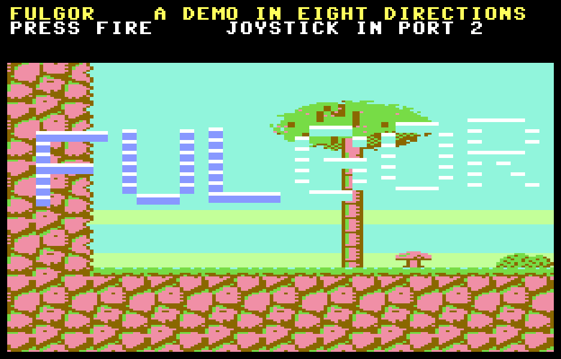
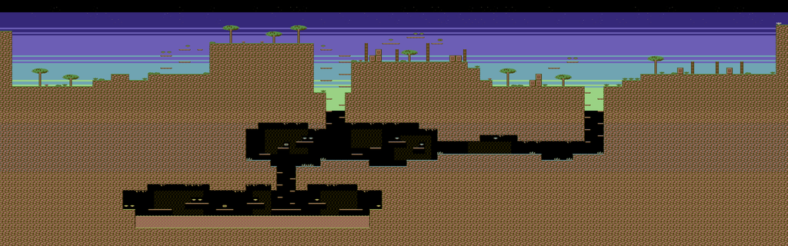

# Claude Fable 5.2 contro il Commodore 64: abbiamo un vero vincitore

*Il giorno dopo l'uscita, il nuovo modello di Anthropic ha scritto in circa due ore un gioco per C64 nella classe di Turrican, disegnando tutto da zero. Ma la macchina del 1982 un bel colpo l'ha messo a segno: un difetto che solo un occhio umano poteva vedere.*

*Registrazione reale dell'emulatore VICE. La GIF gira a 7 immagini al secondo, circa una ogni sei fotogrammi del gioco: illustra il gioco, non ne misura la fluidità. I cambi di scena sono teletrasporti del copione di prova; nel finale l'eroe muore nella lava.*

## Le schede dei due sfidanti

Il 9 novembre 2026 Anthropic ha pubblicato Claude Fable 5.2, un modello pensato, nelle sue parole, per "le sfide tecniche più impegnative". La mattina dopo è salito sul ring contro un avversario imbattuto dal 1982.

| | Claude Fable 5.2 | Commodore 64 |
|---|---|---|
| Debutto | 9 novembre 2026 | 1982 |
| Prezzo | 8 / 40 dollari per milione di token in ingresso / uscita | 595 dollari al lancio |
| Velocità | testo generato fino al 30% più in fretta di Fable 5.1 | CPU 6510 a 0,985 MHz (PAL) |
| Memoria | dato non pubblicato | 64 KB, condivisi con il chip video |
| Grafica | 73,4% su Chartography (lettura di grafici) | 320×200 pixel, 16 colori, 8 sprite hardware |

Nel suo angolo, Fable 5.2 ha portato la tabella dei benchmark pubblicata da Anthropic al lancio. Queste sono le righe in cui viene misurato Fable 5.2:

| Benchmark | Fable 5.2 | Fable 5.1 | Opus 5.5 | GPT-6 Astra | Gemini 4 Carbon |
|---|---|---|---|---|---|
| FrontierCode 2.0 (programmazione agentica) | **49,1%** | 32,4% | 45,5% | 42,8% | 41,1% |
| FrontierSWE v2 (programmazione agentica) | **69,9%** | 56,3% | 62,3% | 65,5% | 61,2% |
| AutomationBench (processi aziendali) | 51,4% | 31,4% | 42,5% | 41,4% | **53,9%** |
| Terminal-Bench-Science 0.1 (ricerca scientifica agentica) | **74,6%** | 52,6% | 58,7% | 68,1% | 64,8% |
| WANDR, punteggio rilassato (ricerca agentica) | **82,1%** | 68,7% | 72,3% | — | — |
| OSWorld 2.1, set offline, parziale (uso del computer) | **89,3%** | 83,5% | 87,2% | 79,5% | 81,5% |
| RoboDojo Sim (robotica) | **64,9%** | 27,6% | 39,4% | 29,8% | — |
| AA-Briefcase v1.1, rubrica (lavoro d'ufficio) | **66,1%** | 61,5% | 61,2% | 52,0% | 61,8% |
| AA-Briefcase v1.1, Elo (lavoro d'ufficio) | 1785 | 1669 | **1800** | 1569 | 1611 |
| Remote Labor Index (lavoro d'ufficio) | **41,3%** | 17,9% | 21,3% | 20,8% | — |
| Humanity's Last Exam, con strumenti | **74,2%** | 65,6% | 67,7% | 57,2% | — |
| Chartography, senza strumenti (lettura di grafici) | **73,4%** | 44,8% | 64,4% | 71,0% | 72,5% |

*Fonte: Anthropic, ["Introducing Claude Fable 5.2 and Claude Mythos 5.2"](https://www.anthropic.com/claude-fable-and-mythos-5-2), 9 novembre 2026. Sono numeri dichiarati da Anthropic, non verificati in modo indipendente. Fable 5.2, Fable 5.1 e Opus 5.5 sono misurati con le protezioni attive, e ogni modello al massimo livello di ragionamento disponibile, salvo dove la tabella originale indica altro: su FrontierCode 2.0 Fable 5.2 e 5.1 sono a livello Xhigh e Gemini 4 Carbon a Medium; sul Remote Labor Index Fable 5.2 è a livello High. RoboDojo Sim è stato eseguito internamente. La tabella originale ha anche tre righe (due di sicurezza informatica e una di progettazione di proteine) misurate su Mythos 5.2, la variante senza le protezioni di Fable: qui sono escluse.*

Il Commodore 64 non pubblica tabelle di benchmark. Ha una sola prova, e la ripete cinquanta volte al secondo: un fotogramma PAL dura 312 linee di quadro, e il gioco o finisce il suo lavoro in tempo o perde il fotogramma. Niente punteggi parziali, niente livelli di ragionamento.

Ecco com'è andato l'incontro:

| Round | Esito |
|---|---|
| Scorrimento in otto direzioni a 50 fotogrammi al secondo | **Fable 5.2**: zero fotogrammi in ritardo durante il gioco |
| Un cielo a bande di colore, sincronizzato al ciclo di CPU | **Fable 5.2**, dopo che la macchina ha corretto il progetto tre volte |
| Un livello intero in 64 KB | **Fable 5.2**: un programma di 46 864 byte |
| Uno sfarfallio sul bordo destro dello schermo | **Commodore 64**: nessuno degli strumenti del modello l'ha visto |

Allora, un vero vincitore c'è? Il verdetto spetta a chi il gioco l'ha giocato, cresciuto con queste macchine. Vista la fluidità di FULGOR, e il fatto che ogni blocco, ogni sprite e l'intero livello sono stati disegnati da zero, il Commodore 64 non ne esce sconfitto: resta un banco di prova incredibile per i modelli generativi, uno che risponde cinquanta volte al secondo e con cui non si discute. Ma Claude Fable 5.2 ha creato un gioco di alto livello in circa due ore, più in fretta e meglio di qualunque altro modello provato prima in questa toolchain. Il vero vincitore è lui. Il resto dell'articolo racconta come è andata.

## La richiesta

La richiesta è arrivata in una riga: analizzare il progetto e poi fare "un gioco per Commodore 64 di alto livello, tipo Turrican 2, da rinominare: la demo del primo livello, non il gioco intero". Il risultato è **FULGOR**, sviluppato da **Claude Fable 5.2** in Claude Code dentro C64AIToolChain, in circa due ore di lavoro, il giorno dopo l'uscita del modello: due ore e mezza dal primo messaggio all'ultima compilazione, di cui 37 minuti di pausa. Il modello non partiva dal nulla. Nella toolchain c'erano già le idee del motore di IRON VEIN e il suo diario, gli strumenti per pilotare e filmare l'emulatore, le regole del progetto. Ma codice, grafica e livello sono stati fatti da zero. Dall'altra parte c'era un umano cresciuto con il VIC-20 e il C64, che guardava lo schermo e interveniva quando qualcosa non gli tornava: i suoi interventi si sono ridotti a due indicazioni sullo scorrimento.

FULGOR è un livello completo da giocare: un eroe di due sprite che corre, salta e spara con tre livelli di potenza dell'arma, tre tipi di nemici (un pattugliatore, una vespa e una torretta che spara), gemme e potenziamenti, energia, vite, checkpoint e lava. C'è un HUD e una schermata del titolo. Il mondo è largo 4 096 pixel e alto 1 280, e si scorre in tutte le otto direzioni. Il motore è tutto in Assembly 6502; il C resta per l'avvio, il testo dell'HUD e i passaggi tra una vita e l'altra. Il programma pesa 46 864 byte.

Di Turrican c'è solo la classe del gioco. Codice, grafica e livello sono originali.

## Che cosa vuol dire "classe Turrican II"

In questo repository c'era già IRON VEIN, un'altra demo a scorrimento in otto direzioni, scritta tre mesi prima da Claude Fable 5.1. Era la base naturale da cui partire. Ma messa accanto a Turrican mostrava i suoi limiti, e il diario di sviluppo di IRON VEIN ne spiegava le cause.

| | IRON VEIN | FULGOR |
|---|---|---|
| velocità | 1 pixel per fotogramma | corsa a 2, cadute fino a 3 |
| sfondo | nero | un cielo a bande di colore |
| eroe | uno sprite, 21 pixel | due sprite sovrapposti, circa 40 pixel |
| collisioni | blocchi da 32 pixel | per carattere, con piattaforme sottili |
| bilancio | 6 nemici, circa 5% di fotogrammi in ritardo | spazio per le armi, zero ritardi |

Le cause stavano nel codice: camera ed eroe scritti in C (2 000 e 1 500 cicli a fotogramma), la copia dello schermo con un indirizzamento lento, gli interrupt che passavano per il KERNAL. Quindi FULGOR ha una cartella nuova e un motore nuovo. Riprende le idee di IRON VEIN che avevano retto, ma l'intero fotogramma è in Assembly.

## La grafica nasce da un programma

Un dettaglio tecnico del C64 decide l'aspetto del gioco. Lo schermo a caratteri ha una memoria dei colori che non si può avere in due copie: si può preparare in anticipo la prossima schermata, ma non i suoi colori. Così il quarto colore di ogni carattere appartiene alla riga del mondo, non al singolo blocco. Il livello è quindi diviso in fasce: verde in superficie, giallo nelle caverne, ciano nella galleria dei cristalli. È un vincolo del motore, e la direzione artistica lo segue.

Il terreno non è disegnato blocco per blocco. Un programma Python genera una trama di roccia di 32×32 pixel che si ripete senza giunture, fatta di celle illuminate dall'alto a sinistra. Da quella ritaglia le sedici varianti dei bordi, con regole per il contorno, l'erba e l'ombra. Anche il livello è un piccolo programma: un profilo del terreno, caverne scavate come rettangoli, sporgenze e decorazioni messe secondo regole. Un visualizzatore ridisegna la mappa e il foglio degli sprite con i colori del gioco. Così la grafica è stata giudicata prima che esistesse una sola riga di 6502.

*Il livello intero, 128×40 blocchi da 32 pixel, come lo disegna `assetgen.py`: altipiani e rovine in superficie, la galleria dei cristalli, la fornace con la lava in basso a sinistra.*

Due correzioni sono venute dal guardare. Il primo abbinamento di colori, marrone e arancio, sembrava fango; otto combinazioni affiancate hanno scelto marrone e rosso chiaro, che si legge come roccia di canyon. Le prime gambe dell'eroe erano generate da uno scheletro di angoli e venivano fuori bastoncini spezzati. Ora sono quattro disegni fatti a mano.

## Il motore era giusto alla prima prova, ed era lento

Alla prima accensione lo scorrimento, l'eroe e le collisioni erano corretti. Poi è arrivato il contatore. Un fotogramma PAL dura 312 linee di quadro, e il lavoro di un fotogramma finiva alla linea 219 con il solo eroe in scena che correva, saltava e sparava. Era troppo, prima ancora di aggiungere un nemico.

Un profilatore a cinque punti di controllo ha dato i nomi ai costi:

- **il multiplexer degli sprite costava 1 950 cicli per mostrare il solo eroe.** Il C64 ha otto sprite hardware e il multiplexer li riusa più volte lungo lo schermo. Ogni fotogramma scorreva e ordinava tutti i sedici oggetti possibili. Ora tiene una lista degli oggetti vivi già ordinata per altezza, che cambia di un passo quando serve, e l'interrupt entra in una scala già srotolata al gradino giusto;
- **la copia dello schermo costava 4 200 cicli per ciascuna delle due metà.** Scorrere di un carattere vuol dire spostare tutto lo schermo nel buffer nascosto. Ora la copia è divisa in bande, distribuite sui fotogrammi che restano prima del passo, mai più di due per fotogramma. Se il buffer non è pronto, la camera aspetta al confine per un fotogramma: è meglio di un fotogramma perso;
- **i controlli laterali delle collisioni costavano 115 cicli l'uno.** Ora la colonna e il suo bit si calcolano una volta sola.

| | fermo | in corsa | corsa, salto e fuoco |
|---|---|---|---|
| prima versione | 64 linee | ~120, peggiore 149 | peggiore 219 |
| dopo | 42 | ~94, peggiore 120 | peggiore ~195 |

C'era anche un errore di progettazione del livello, trovato con una misura. Il salto dell'eroe sale di 49 pixel, e la prima bozza aveva un fosso profondo tre blocchi, cioè 96 pixel. Da allora le regole stanno scritte nel generatore del livello: ogni gradino è di un blocco, ogni fosso largo un blocco, i pozzi larghi tre con le sporgenze alternate.

## Il cielo: un interrupt che non può arrivare in ritardo

Il cielo di FULGOR è un gradiente di bande di colore, e le bande scorrono con il mondo. Il C64 ha un solo registro per il colore di fondo. Per avere le bande bisogna cambiarlo nel punto esatto in cui finisce una riga di caratteri, che a ogni fotogramma si trova su una linea diversa perché lo schermo scorre. Un cambio sbagliato di pochi cicli si vede come un gradino nel mezzo di una riga.

Il normale interrupt di quadro non basta, perché il multiplexer degli sprite usa gli stessi interrupt e può ritardarlo. FULGOR usa l'interrupt non mascherabile (NMI) del secondo chip CIA. Un timer è lungo esattamente un fotogramma PAL (19 656 cicli), sincronizzato una volta all'avvio con il pennello elettronico. Da quel momento scatta sempre nello stesso punto dello schermo. Il suo gestore legge il timer per sapere di quanti cicli è in ritardo, salta dentro una sequenza di istruzioni nel punto che compensa esattamente quel ritardo, e fa partire un secondo timer che scatta ogni 504 cicli, cioè ogni otto linee, una riga di caratteri.

La macchina ha corretto la carta tre volte, una misura per correzione:

- un salto condizionale che doveva essere incondizionato disarmava la catena ogni volta che il primo ritardo era inferiore a 256 cicli;
- con lo scorrimento verticale a 5, la linea di partenza diventa una "bad line", una linea in cui il chip video ferma il processore per 40 cicli. L'interrupt arrivava in ritardo. Quel caso ha ora un gestore suo;
- con lo scorrimento a 7, la prima banda cade 46 cicli dopo l'avvio e sulla carta poteva sovrapporsi all'uscita del gestore precedente. La soluzione ha richiesto un ordine preciso delle conferme e gestori tutti nella stessa pagina di memoria.

Lo stesso NMI ha risolto un vecchio difetto di IRON VEIN. Dove l'HUD incontra il campo di gioco c'è una striscia frastagliata, perché la prima riga compare e scompare con lo scorrimento. FULGOR accende lì una modalità video non valida, che il chip mostra nera, e l'NMI la spegne su una linea fissa. Il bordo superiore del campo ora è pulito in tutte le otto fasi di scorrimento. Misurato con i breakpoint, ogni scrittura del colore comincia tra il ciclo 55 e il 60 dell'ultima linea della riga, e il colore cambia davvero tre cicli dopo, quando la parte visibile della linea è già finita; se il recupero dei dati degli sprite ritarda l'interrupt, può scivolare nei primi cicli della linea successiva, ancora nel bordo sinistro. Le catture dello schermo in tutte le otto fasi di scorrimento lo confermano: nessun confine di banda mostra in anticipo il colore nuovo in fondo a una linea, né in ritardo il colore vecchio all'inizio della successiva.

## Il gioco sopra il motore

Poi sono arrivati i nemici, e il bilancio è saltato di nuovo: linea 253 su 312. Il profilatore ha detto che la tabella degli sprite costava 340 cicli per sprite, non i 230 stimati, perché faceva tre passate su variabili in memoria normale. Ora è una passata sola in pagina zero, circa 225 cicli. La copia dello schermo è passata da tre a quattro bande e le cadute sono state limitate a 3 pixel per fotogramma, così il fotogramma più pesante copia due bande da dieci colonne. Il fotogramma peggiore in gioco arriva ora alla linea 213–233 su 312, con zero fotogrammi in ritardo.

Un dettaglio di gioco è venuto dalla geometria. I primi nemici camminavano a terra, alti 21 pixel. L'arma dell'eroe è a 24 pixel da terra, quindi i colpi passavano sopra le loro teste. Ora tutti i nemici stanno a mezz'aria, all'altezza dell'arma.

## Il difetto sul lato destro

A questo punto l'umano, guardando il gioco, ha scritto: *"ho visto un problema di scrolling sul lato destro"*.

Gli strumenti del modello non vedevano niente. Le schermate prese a caso erano pulite. Un verificatore che fermava l'emulatore e confrontava lo schermo con la mappa era pulito anche lui. Il motivo, capito dopo, è che il monitor di VICE ferma la macchina alla fine del fotogramma, prima che il codice di scorrimento abbia lavorato: si fermava sempre nell'istante sbagliato per vedere il difetto.

Il verificatore è stato spostato. Ora `check.py` mette un punto di arresto all'ingresso della routine che consegna il fotogramma, quando il ciclo principale ha finito di scrivere. Lì legge quale buffer sta mostrando il chip video e confronta tutte le 840 celle del campo con quello che dice il livello. Risultato: **14 campioni su 60 sbagliati, sempre nelle colonne da 30 a 39**, e solo nei fotogrammi in cui la camera faceva un passo.

La causa era nel nuovo pianificatore del motore. Lo scambio tra il buffer visibile e quello preparato si decide un fotogramma prima di vederlo. In quello stesso fotogramma il motore cominciava già a preparare il passo successivo, scrivendo nel buffer che era ancora sullo schermo. La prima banda copiata è quella delle dieci colonne di destra. Per un istante, a ogni passo, il quarto destro dello schermo mostrava il mondo spostato di un carattere. A 50 Hz l'occhio lo vede come uno sfarfallio; una schermata ferma non lo vede mai. IRON VEIN non aveva questo problema perché preparava prima di decidere: l'errore è nato con il pianificatore nuovo.

La correzione: **tre buffer dello schermo a rotazione** invece di due. La preparazione legge il buffer appena diventato visibile e scrive in quello che non è né il nuovo né quello ancora sullo schermo. Costa 24 routine di copia invece di 16, un chilobyte di codice in più e un chilobyte di memoria video, nessun ciclo. Dopo la correzione: 0 campioni sbagliati su 70, su 49 posizioni della camera, correndo a destra e saltando. A fine giornata le stesse prove verso sinistra e in caduta: 0 su 110, su altre 71 posizioni.

## Lo strumento che rallentava il gioco

Subito dopo, l'umano ha scritto di nuovo: *"quando il personaggio principale si muove ora va a scatti, tipo un fotogramma al secondo"*.

Il gioco non c'entrava. Il verificatore stava girando mentre l'umano guardava. Ogni campione è un punto di arresto e una lettura di 3 KB di memoria, e un'esecuzione interrotta aveva lasciato il punto di arresto attivo. Una misura senza nessuno davanti ha confermato che il gioco andava a 50 fotogrammi.

La regola c'era già, nelle note del progetto, imparata con un gioco precedente: non toccare il monitor dell'emulatore mentre qualcuno guarda lo schermo. Il modello l'ha imparata di nuovo. Per le prove di chiusura ha usato una seconda copia di VICE su un'altra porta, lasciando intatta quella in cui l'umano stava giocando.

## Che cosa ha visto il modello visivo

Le regole del progetto chiedono di far guardare il gioco anche a un modello visivo (un VLM). Tre fotogrammi della GIF sono stati dati a gemma4:31b, con la richiesta di descrivere la scena e cercare difetti. Ha letto correttamente l'HUD in tutti e tre, punteggio compreso; ha descritto eroe, nemici, colpi, cielo e terreno; non ha trovato difetti. In un fotogramma ha descritto la lava come "piastrelle rosa e gialle".

È un buon risultato, ma va letto per quello che è. Il difetto del lato destro esisteva per una frazione di fotogramma, e solo in certi fotogrammi. Nessuna immagine ferma lo avrebbe mostrato, a un modello o a una persona. Lo ha visto un occhio che guardava il gioco muoversi.

## Dove siamo arrivati

FULGOR si gioca dal titolo alla fine del livello. Le misure sulla versione finale: 1 046 fotogrammi (una ventina di secondi) di corsa, salto e fuoco con zero fotogrammi in ritardo e il fotogramma peggiore alla linea 213 su 312; fino a circa 233 nelle scene più piene. Lo schermo coincide con la mappa in 180 campioni presi nell'istante in cui il difetto si sarebbe visto, in tutte le direzioni provate.

Restano aperte diverse cose:

- **il finale**: non c'è un boss, il livello finisce raggiungendo l'uscita. Mancano anche il raggio rotante e la trasformazione in ruota che fanno Turrican;
- **le cadute lunghe**: la camera a volte aspetta al confine e resta indietro di qualche pixel (39 attese in 11 secondi di una prova con una caduta lunga);
- **il logo del titolo** si legge poco sul cielo chiaro.

## Che cosa insegna

L'articolo su IRON VEIN si chiudeva dicendo che ogni problema serio era stato trovato da un numero, non dallo sguardo. FULGOR aggiunge una precisazione. Un numero vede solo l'istante in cui lo prendi. Il verificatore non era sbagliato: guardava nel momento sbagliato, e per questo diceva "tutto a posto". Lo sguardo dell'umano vede cinquanta immagini al secondo e le somma, e ha trovato il sintomo che gli strumenti non vedevano. Poi lo strumento, spostato nel punto giusto, ha trovato la causa. Nessuno dei due da solo sarebbe arrivato in fondo.

Vale anche il contrario: misurare costa. Lo stesso verificatore, acceso mentre l'umano guardava, ha trasformato un gioco fluido in una sequenza di scatti, e il nuovo sintomo era stato causato dallo strumento stesso.

---

**Materiali:** [gioco, sorgenti e comandi](../fulgor/README.md), [diario di sviluppo completo](../fulgor/DEVLOG.md), [il verificatore schermo/mappa](../fulgor/check.py), [risposte del modello visivo](../fulgor/evidence/vlm_review.md).

*Gioco sviluppato da Claude Fable 5.2 in Claude Code. Verifiche di chiusura, nuova registrazione e testo preparati da Claude Opus 5.5 a partire dal diario e dalle prove della sessione, per la revisione e la pubblicazione dell'utente. Nessuna pubblicazione è stata effettuata.*
