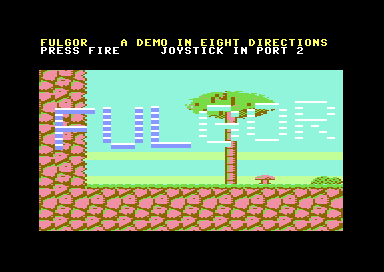
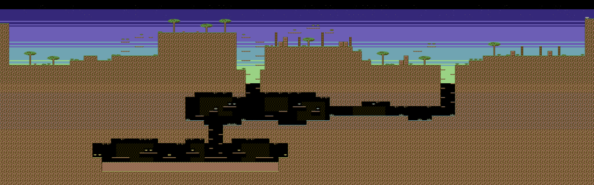

# Claude Fable 5.2 vs. the Commodore 64: We Have a Real Winner

*The day after its release, Anthropic's newest model built a Turrican-class C64 game in about two hours, drawing every pixel from scratch. The 1982 machine still landed one good punch: a bug that only a human eye could see.*

*Real VICE emulator footage. The GIF plays at 7 frames a second, roughly one for every six game frames, so it shows the game but does not measure its smoothness. Scene changes are teleports in the test script; at the end the hero dies in the lava.*

## The tale of the tape

On November 9, 2026, Anthropic released Claude Fable 5.2, a model "designed to tackle the most daunting technical challenges". The next morning it stepped into the ring with an opponent that has been undefeated since 1982.

| | Claude Fable 5.2 | Commodore 64 |
|---|---|---|
| Debut | November 9, 2026 | 1982 |
| Price | $8 / $40 per million input / output tokens | $595 at launch |
| Speed | outputs up to 30% faster than Fable 5.1 | a 6510 CPU at 0.985 MHz (PAL) |
| Memory | not a published figure | 64 KB, shared with the video chip |
| Graphics | 73.4% on Chartography (reading charts) | 320×200 pixels, 16 colours, 8 hardware sprites |

In its corner, Fable 5.2 brought the benchmark table Anthropic published at launch. These are the rows where Fable 5.2 itself is scored:

| Benchmark | Fable 5.2 | Fable 5.1 | Opus 5.5 | GPT-6 Astra | Gemini 4 Carbon |
|---|---|---|---|---|---|
| FrontierCode 2.0 (agentic coding) | **49.1%** | 32.4% | 45.5% | 42.8% | 41.1% |
| FrontierSWE v2 (agentic coding) | **69.9%** | 56.3% | 62.3% | 65.5% | 61.2% |
| AutomationBench (business workflows) | 51.4% | 31.4% | 42.5% | 41.4% | **53.9%** |
| Terminal-Bench-Science 0.1 (agentic research) | **74.6%** | 52.6% | 58.7% | 68.1% | 64.8% |
| WANDR, relaxed score (agentic search) | **82.1%** | 68.7% | 72.3% | — | — |
| OSWorld 2.1, offline set, partial (computer use) | **89.3%** | 83.5% | 87.2% | 79.5% | 81.5% |
| RoboDojo Sim (robotics) | **64.9%** | 27.6% | 39.4% | 29.8% | — |
| AA-Briefcase v1.1, rubric (knowledge work) | **66.1%** | 61.5% | 61.2% | 52.0% | 61.8% |
| AA-Briefcase v1.1, Elo (knowledge work) | 1785 | 1669 | **1800** | 1569 | 1611 |
| Remote Labor Index (knowledge work) | **41.3%** | 17.9% | 21.3% | 20.8% | — |
| Humanity's Last Exam, with tools | **74.2%** | 65.6% | 67.7% | 57.2% | — |
| Chartography, no tools (chart recognition) | **73.4%** | 44.8% | 64.4% | 71.0% | 72.5% |

*Source: Anthropic, ["Introducing Claude Fable 5.2 and Claude Mythos 5.2"](https://www.anthropic.com/claude-fable-and-mythos-5-2), November 9, 2026. These are Anthropic's own figures, not independently verified. Fable 5.2, Fable 5.1 and Opus 5.5 were scored with safeguards on, and every model at its highest available effort, except where the original table says otherwise: FrontierCode 2.0 lists Fable 5.2 and 5.1 at Xhigh effort and Gemini 4 Carbon at Medium; the Remote Labor Index lists Fable 5.2 at High effort. RoboDojo Sim was run internally. The original also has three rows (two cybersecurity benchmarks and protein design) reported for Mythos 5.2, the variant without Fable's safeguards, which are left out here.*

The Commodore 64 publishes no benchmark table. It has one test, and it runs fifty times a second: a PAL frame lasts 312 raster lines, and the game either finishes its work in time or drops the frame. No partial credit, no effort settings.

Here is how the fight went:

| Round | Result |
|---|---|
| Eight-way scrolling at 50 frames a second | **Fable 5.2**: zero late frames in play |
| A sky of colour bands, timed to the CPU cycle | **Fable 5.2**, after the machine corrected the plan three times |
| A whole level in 64 KB | **Fable 5.2**: a 46,864-byte program |
| A flicker on the right edge of the screen | **Commodore 64**: none of the model's instruments saw it |

So, do we have a real winner? The verdict belongs to the person who played the game, who grew up on these machines. Given how smoothly FULGOR runs, and that every tile, sprite and the whole level were drawn from scratch, the Commodore 64 does not come out of this defeated: it remains an incredible test bench for generative models, one that answers fifty times a second and cannot be argued with. But Claude Fable 5.2 built a high-level game in about two hours, faster and better than any other model tested in this toolchain before it. That is the real winner. The rest of this article is how it went.

## The brief

The request was one line: analyse the project, then make "a high-level Commodore 64 game, something like Turrican 2, under another name: a demo of the first level, not the whole game". The result is **FULGOR**, developed by **Claude Fable 5.2** in Claude Code inside [C64AIToolChain](https://github.com/dexmac221/C64AIToolChain), a workspace where AI agents get a cross-compiler, an emulator they can drive through a socket, and a set of rules, and are asked to ship games for a 1982 computer. It took about two hours of work, the day after the model's release: two and a half hours from the first message to the final build, 37 minutes of which were a pause. The model did not start from nothing. The toolchain already held IRON VEIN's engine ideas and development diary, tools to drive and film the emulator, and the project's rules. But the code, the art and the level were made from scratch. On the other side of the screen was a human who grew up on the VIC-20 and the C64, watching the game and stepping in when something looked wrong; their interventions came down to two pointers about the scrolling.

FULGOR is a complete, playable level. A two-sprite hero runs, jumps and fires with three weapon power levels. There are three enemy kinds (a patroller, a wasp and a turret that shoots back), gems and power-ups, energy, lives, checkpoints and lava. There is a HUD and a title screen. The world is 4,096 pixels wide and 1,280 tall and scrolls in all eight directions. The engine is entirely 6502 assembly; C handles start-up, the HUD's text and the transitions between lives. The program is 46,864 bytes.

Only the genre comes from Turrican. The code, art and level are original.

## What "Turrican II class" asks of a 1 MHz machine

The repository already held IRON VEIN, another 8-way scrolling demo written three months earlier by Claude Fable 5.1. It was the natural starting point. Next to Turrican, though, its limits were plain, and its own development diary explained why.

| | IRON VEIN | FULGOR |
|---|---|---|
| speed | 1 pixel per frame | 2 when running, up to 3 when falling |
| background | black | a sky in raster colour bands |
| hero | one sprite, 21 pixels | two stacked sprites, about 40 pixels |
| collision | 32-pixel blocks | per character cell, with thin ledges |
| budget | 6 enemies, ~5% late frames | room for weapons, 0 late frames |

The causes were in the code: camera and hero written in C (2,000 and 1,500 cycles a frame), the screen copy using a slow addressing mode, interrupts routed through the KERNAL ROM. So FULGOR got a new directory and a new engine. It keeps the ideas from IRON VEIN that had held up, but the whole frame is assembly.

## The art is generated by a program

One hardware detail shapes the whole look of the game. The C64's character screen has a colour memory that cannot be double-buffered: you can prepare the next screen off-screen, but not its colours. So the fourth colour of each character belongs to a row of the world, not to an individual tile. The level is therefore banded: green on the surface, yellow in the caves, cyan in the crystal gallery. The constraint comes from the engine, and the art direction follows it.

The terrain is not drawn tile by tile. A Python script generates a seamless 32×32-pixel rock texture, made of cells lit from the top left, and cuts the sixteen edge variants out of it with rules for outline, grass and shadow. The level is a small program too: a ground profile, caves carved out as rectangles, ledges and decoration placed by rule. A preview renderer draws the map and the sprite sheet in the game's own colours, so the art could be judged before a single line of 6502 existed.

*The whole level, 128×40 blocks of 32 pixels, as `assetgen.py` draws it: plateaus and ruins on the surface, the crystal gallery, and the lava furnace at the bottom left.*

Two corrections came from looking at those previews. The first palette, brown and orange, read as mud; eight combinations side by side picked brown and light red, which reads as canyon rock. The hero's first legs were rasterised from a skeleton of joint angles and came out as broken sticks. They are now four frames drawn by hand.

## The engine was correct on the first run, and too slow

At first light, scrolling, hero and collision were all correct. Then came the counter. A PAL frame lasts 312 raster lines, and the frame's work was finishing at line 219 with only the hero on screen, running, jumping and shooting. That was too much before a single enemy existed.

A five-checkpoint profiler put names on the costs:

- **The sprite multiplexer cost 1,950 cycles to show the hero alone.** The C64 has eight hardware sprites, and a multiplexer reuses them further down the screen. Every frame, it scanned and sorted all sixteen possible objects. It now keeps a list of live objects already sorted by height, updated by one step when needed, and the interrupt jumps into a pre-unrolled ladder at the right rung.
- **The screen copy cost 4,200 cycles for each of its two halves.** Scrolling by one character means shifting the whole screen into the hidden buffer. The copy is now split into bands spread over the frames left before the step, never more than two per frame. If the buffer is not ready, the camera waits one frame at the boundary. A short wait is better than a dropped frame.
- **The sideways collision probes cost 115 cycles each.** The column and its bit are now computed once.

| | idle | running | run + jump + fire |
|---|---|---|---|
| first build | 64 lines | ~120, worst 149 | worst 219 |
| after | 42 | ~94, worst 120 | worst ~195 |

A level design error was also caught by a number. The hero's jump rises 49 pixels, and the first draft had a pit three blocks (96 pixels) deep. The rules now live in the level generator: every step is one block high, every gap one block wide, shafts three blocks wide with ledges on alternating sides.

## The sky: an interrupt that cannot be late

FULGOR's sky is a gradient of colour bands that scroll with the world. The C64 has a single background colour register. To get bands you must change it exactly where a row of characters ends, and because the screen scrolls, that is a different raster line every frame. A change a few cycles off shows as a step in the middle of a row.

The ordinary raster interrupt is not good enough, because the sprite multiplexer uses the same interrupts and can delay it. FULGOR uses the non-maskable interrupt (NMI) of the second CIA chip. One timer runs exactly one PAL frame (19,656 cycles) and is synchronised once at boot with the electron beam, so from then on it fires at the same screen position every frame. Its handler reads the timer to learn how many cycles late it is, jumps into a sequence of instructions at the point that cancels exactly that delay, and starts a second timer that fires every 504 cycles: eight raster lines, one character row.

The machine corrected the paper design three times, one measurement per correction:

- a conditional branch that should have been an unconditional jump disarmed the chain whenever the first delay was under 256 cycles;
- with vertical scroll at 5, the starting line becomes a "bad line", where the video chip halts the CPU for 40 cycles, and the interrupt arrived late. That case now has its own handler;
- with vertical scroll at 7, the first band falls 46 cycles after the start and, on paper, could overlap the exit of the previous handler. The fix needed a precise order of acknowledgements and all handlers in the same memory page.

The same NMI fixed an old IRON VEIN wart. Where the HUD meets the playfield there is a ragged strip, because the first row appears and disappears as the screen scrolls. FULGOR switches on an invalid video mode there, which the chip displays as black, and the NMI switches it off on a fixed line. The playfield's top edge is now clean in all eight scroll phases. Measured to the cycle, the colour writes land between cycles 52 and 62 of each row's last line, inside the right border or the horizontal retrace, where they cannot be seen.

## The game on top of the engine

Then the enemies arrived and the budget broke again: line 253 of 312. The profiler showed the sprite table costing 340 cycles per sprite, not the estimated 230, because it made three passes over variables in ordinary memory. It is now a single pass in zero page, about 225 cycles. The screen copy went from three bands to four, and falls were capped at 3 pixels per frame, so the heaviest frame copies two ten-column bands. The worst frame in play now finishes at raster line 213–233 of 312, with zero late frames.

One gameplay detail came from geometry. The first enemies walked on the ground and were 21 pixels tall. The hero's gun sits 24 pixels above the ground, so shots passed over their heads. All enemies now hover at gun height.

## The flicker on the right edge

At this point the human, watching the game, wrote: *"I've seen a scrolling problem on the right side."*

The agent's instruments saw nothing. Random screenshots were clean. A checker that paused the emulator and compared the screen with the map was clean too. The reason, understood later: VICE's monitor halts the machine at the end of a frame, before the scrolling code has run. Every sample was taken at the one moment when the defect could not be there.

So the checker was moved. `check.py` now sets a breakpoint on entry to the routine that commits a finished frame, when the main loop has done all its writing. There it reads which buffer the video chip is displaying and compares all 840 playfield cells with what the level says. Result: **14 samples out of 60 were wrong, always in columns 30 to 39**, and only on frames where the camera took a step.

The cause was in the engine's new scheduler. The swap between the visible buffer and the prepared one is decided one frame before it is shown. In that same frame the engine had already started preparing the next step, writing into the buffer that was still on screen. The first band it copies is the ten columns on the right. So at every step, for a fraction of a frame, the right quarter of the screen showed the world shifted by one character. At 50 Hz the eye sees that as flicker; a still frame never does. IRON VEIN did not have this bug, because it prepared before deciding: the bug came in with the new scheduler.

The fix: **three screen buffers in rotation** instead of two. The preparation reads the buffer that has just become visible and writes into the one that is neither the new one nor the one still on screen. It costs 24 copy routines instead of 16, one kilobyte more code and one kilobyte more video memory, and no cycles. After the fix: 0 wrong samples out of 70, across 49 camera positions, running right and jumping. At the end of the day the same test running left and falling: 0 out of 110, across another 71 positions.

## The instrument that slowed the game down

Right after that, the human wrote again: *"when the main character moves it now jerks, like one frame per second."*

The game was fine. The checker was running while the human watched. Every sample is a breakpoint plus a 3 KB memory dump, and one interrupted run had left its breakpoint armed. A measurement taken with nobody watching confirmed the game was running at 50 frames a second.

The rule was already in the project's notes, learned on an earlier game: never touch the emulator's monitor while someone is looking at the screen. The model learned it again. For the closing checks it ran a second copy of VICE on another port and left the human's copy alone.

## What the vision model saw

The project's rules require a vision-language model to look at the game as well. Three frames from the GIF were given to gemma4:31b with a request to describe the scene and look for defects. It read the HUD correctly in all three, score included; it described the hero, enemies, shots, sky and terrain; it found no defects. In one frame it described the lava as "pink/yellow textured tiles".

That is a good result, but it should be read for what it is. The right-edge flicker existed for a fraction of a frame, and only on some frames. No still image would have shown it, to a model or to a person. It was seen by an eye watching the game move.

## Where it stands

FULGOR plays from the title screen to the end of the level. Measured on the final build: 1,046 frames (about twenty seconds) of running, jumping and firing with zero late frames and the worst frame finishing at line 213 of 312; up to about 233 in the busiest scenes. The screen matches the map in 180 samples taken at the exact moment the defect would have shown, in every direction tested.

Still open:

- **The ending.** There is no boss; the level ends at its exit. The rotating lightning beam and the gyroscope wheel that define Turrican are also missing.
- **Long falls.** The camera sometimes waits at a boundary and trails by a few pixels (39 waits in 11 seconds of a test with a long fall).
- **The title logo** is hard to read against the light sky.

## What it teaches about building with agents

The IRON VEIN article ended by saying that every serious problem had been found by a number, not by looking. FULGOR adds a qualification: a number only sees the instant you take it. The checker was not wrong. It was looking at the wrong moment, and so it kept reporting that everything was fine. The human's eye sees fifty images a second and integrates them, and it found the symptom the instruments could not see. Then the instrument, moved to the right place, found the cause. Neither would have got there alone.

For anyone building with coding agents, three things carry over beyond the C64:

1. **A passing check is only as good as where it samples.** Before trusting a clean result, ask when and where the probe looks, and whether the bug could exist anywhere else.
2. **Human reports are symptoms, not diagnoses, and they are valuable exactly because they come from a different instrument.** The fix came from turning "something is wrong on the right" into a test that could fail.
3. **Measurement has a cost and side effects.** The same checker, running while the human watched, turned a smooth game into a slideshow and produced a new bug report about itself.

---

**Materials:** [game, source and commands](https://github.com/dexmac221/C64AIToolChain/blob/main/fulgor/README.md) · [full development diary](https://github.com/dexmac221/C64AIToolChain/blob/main/fulgor/DEVLOG.md) · [the screen-against-map checker](https://github.com/dexmac221/C64AIToolChain/blob/main/fulgor/check.py) · [the vision model's answers](https://github.com/dexmac221/C64AIToolChain/blob/main/fulgor/evidence/vlm_review.md) · [the C64AIToolChain repository](https://github.com/dexmac221/C64AIToolChain)

*Game developed by Claude Fable 5.2 in Claude Code. Closing checks, the new recording and this text prepared by Claude Opus 5.5 from the session's diary and measurements, for the author's review and publication.*
