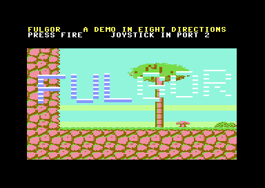
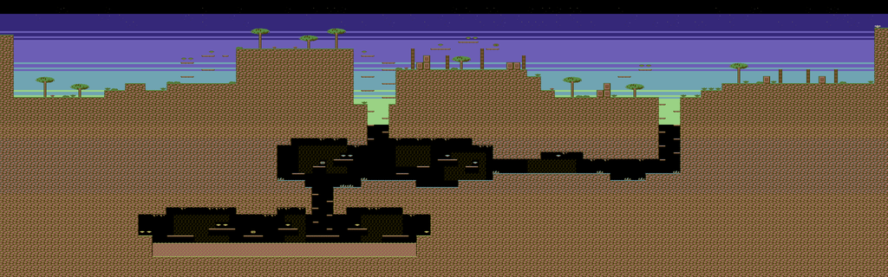

# FULGOR

An 8-way scrolling action game for the Commodore 64 (PAL) in the class of
Turrican II: the first level as a demo. Built by Claude Fable 5.2 in Claude
Code on 2026-11-10, the day after its release, in about two hours of
work. Code, art, level and music are original.

Run, jump and shoot through a 4096×1280-pixel world: a surface of
plateaus and ruins under a raster-band sky, a crystal gallery, tunnels
and a lava furnace. Three weapon levels, three enemy kinds (a patroller,
a wasp, a turret that fires), gems and power units, energy, lives,
checkpoints, a title screen, and a three-voice SID tune with seven sound
effects.

**Play:** `./run_vice.sh` (sound off) or `./run_vice.sh sound`.
Joystick in port 2: up jumps, fire shoots. `fulgor.prg` is included
pre-compiled.

**Build:** `./build.sh` (cc65 2.18 and Python 3; Pillow only for
`assetgen.py --preview`).
`PROFILE=1 ./build.sh` adds raster-line checkpoints at `$0370`.

The development diary, dead ends included, is [DEVLOG.md](DEVLOG.md); the
article is [articles/FULGOR_TOWARDS_AI.md](../articles/FULGOR_TOWARDS_AI.md)
([Italian version](../articles/FULGOR_MEDIUM_IT.md)).

## The engine

All of the frame is 6502 assembly (`engine.s`, `game.s`, `sound.s`); C
(`main.c`) keeps start-up, the HUD's text and the steps between lives.

- **Scrolling**: three screen buffers in rotation (`$4400/$4800/$4C00`),
  21 playfield rows, 24 unrolled copy routines (8 directions × 3 buffer
  pairs). The next step is prepared in units (entering column, entering
  row, four 10-column copy bands), at most two a frame; the camera waits
  a frame at the boundary rather than lose one. The main loop *commits*
  a frame and the frame interrupt applies buffer, fine scroll, row
  colours and sprite bank together, or nothing.
- **Colour per world row**: colour RAM cannot be double-buffered, so the
  fourth ink of a character belongs to the world row and the level is
  banded.
- **Sky**: `$D021` per world row by NMI. CIA 2 timer B runs one PAL
  frame (19 656 cycles), synchronised once at boot; its handler removes
  its own jitter and starts timer A at 504 cycles (one character row).
  Each store starts on cycles 55-60 of a row's last line (VICE numbering,
  from 0) and writes three cycles later, after the 38-column window has
  closed; sprite fetches can push it into the first cycles of the next
  line, still in the left border. Checked on screen in all eight
  fine-scroll phases (`evidence/band_edges.md`). An invalid ECM+MCM mode masks the ragged first row,
  so the playfield's top edge is clean.
- **Sprites**: a multiplexer over all eight hardware sprites, with a
  live-object list kept in Y order, an unrolled IRQ ladder for the first
  eight and raster IRQs for the rest; about 225 cycles a sprite.
- **Collision** by character cell, with one-way ledges.
- **Art and level** are generated by `assetgen.py`: one procedural rock
  texture cut into 16 autotile variants, the level built by a small
  program, `--preview DIR` renders the map and the sprite sheet.
  `music.py` writes the tune and the sound effects.

## Measured

- Shipping build: 1 046 frames of run, jump and fire with 0 late frames,
  worst frame done at raster line 213 of 312; up to ~233 in the heaviest
  scenes with music.
- Screen against map (`check.py`, which stops at the entry of `_commit`
  and compares all 840 playfield cells with the level): 0 wrong in 180
  samples over 120 camera positions, running right, left, jumping and
  falling. With two buffers the same test found 14 wrong in 60, always
  columns 30..39: the right-hand flicker the human saw.

## Agent and test hooks

| address | use |
|---|---|
| `$033C` | one joystick press (cleared when read): up 1, down 2, left 4, right 8, fire 16 |
| `$033E` | joystick bits held |
| `$0341` | n = 1..10: drop the hero at spot n |
| `$0350` | telemetry: frames, late frames, worst commit line, stalls, flips, histogram (see `defs.inc`) |

`check.py --port N --start --spot S --hold BITS` runs the screen check on
a VICE whose remote monitor is on port N. **Never run it, or anything
else on the monitor, while someone is watching the game**: every sample
is a breakpoint and a 3 KB dump, and the game crawls. Use a second VICE
on another port.

## Open

No boss: the level ends at its exit. No lightning beam or wheel. The
camera can lag a few pixels during long falls. The title logo is hard to
read on the light sky.
